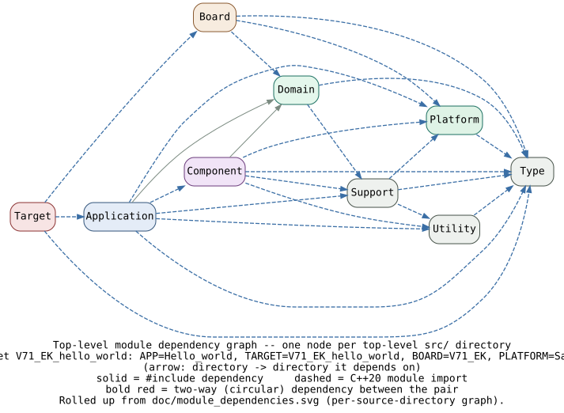
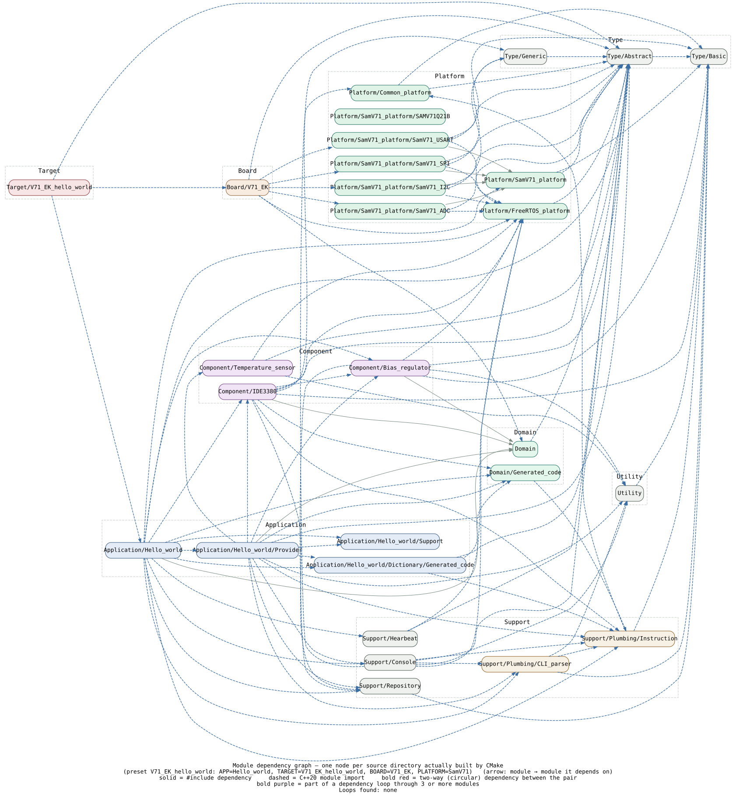
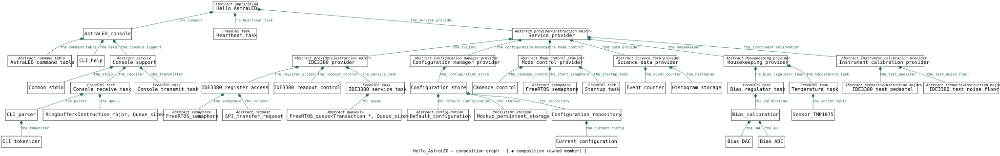
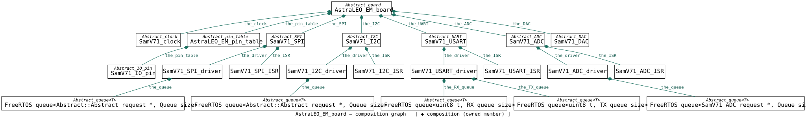
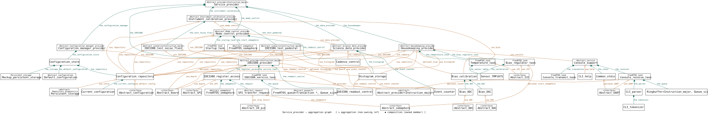
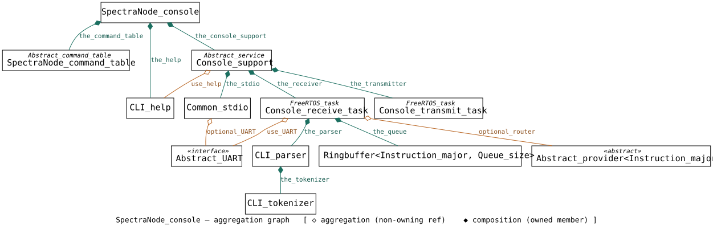
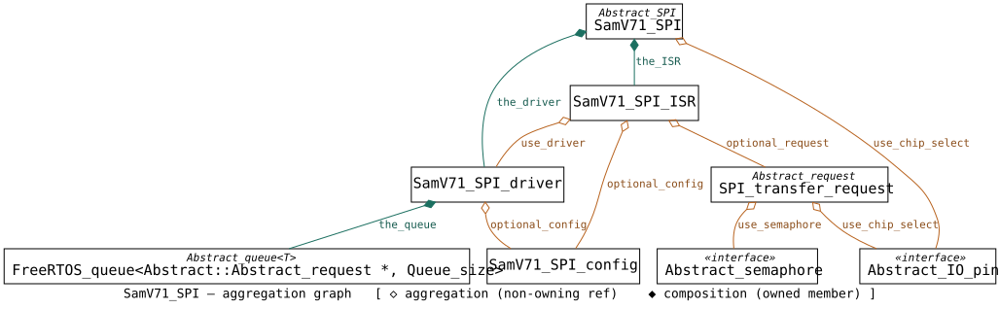
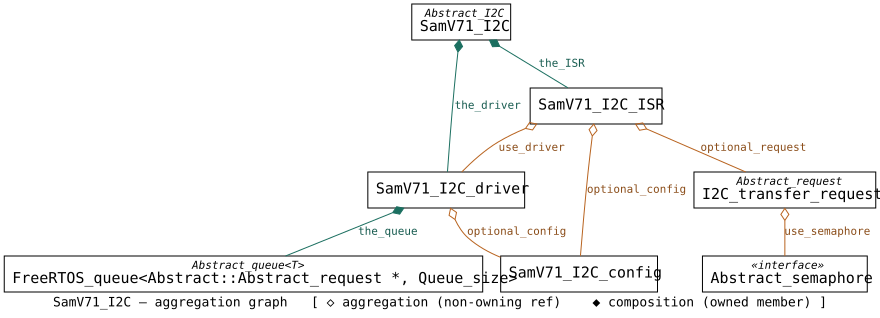
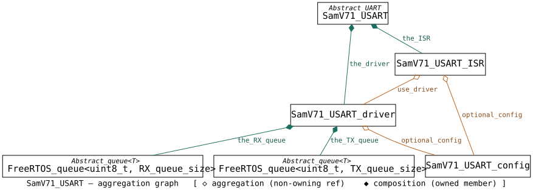
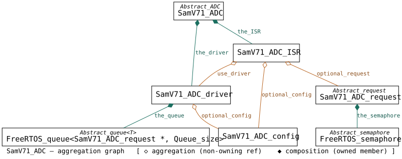

# AstraLEO Explore SAMV71 Peripherals, etc.

Build using GCC and C++20.
Using FreeRTOS (FreeRTOSv202604.01-LTS).

Current firmware version: **1.6.1** (`IDE_SW_VERSION` in `CMakeLists.txt`).

## Building

The build is driven by `CMakePresets.json` (Ninja, output in `build/<preset>/`,
executables in `bin/`). Each preset selects four cache variables that pick which source
directories are compiled in:

| Preset | `APP` | `TARGET` | `BOARD` | `PLATFORM` |
|---|---|---|---|---|
| `Hello_AstraLEO_EM` | `Hello_AstraLEO` | `Hello_AstraLEO_EM` | `AstraLEO_EM` | `SamV71` (produces `.elf`) |
| `Hello_AstraLEO_Win11` | `Hello_AstraLEO` | `Hello_AstraLEO_Win11` | `Win11` | `Win11` |
| `Unit_test` | — | `Unit_test` | `Win11` | `Win11` |
| `Win_ethernet_test` / `V71_ethernet_test` | — | (on hold) | `Win11` / `AstraLEO_EM` | `Win11` / `SamV71` |

```sh
cmake --preset Hello_AstraLEO_EM
cmake --build build/Hello_AstraLEO_EM
```

## SPI (IDE3380 ASIC interface, V1.3)

`SamV71_SPI` (`src/Platform/SamV71_platform/`) talks to up to five IDE3380 ASICs:

- **Bitrate** 2 Mbps (was 100 kbps in V1.2).
- **Mode** CPOL=0 (clock idles low), NCPHA=1 (data captured on the leading edge, changed
  on the trailing edge).
- **Chip select** is asserted *before* the SPI peripheral is enabled for each transfer.
- **Pins** (`AstraLEO_EM_pin_table.cppm`): MISO has a pull-down, MOSI a pull-up.
- **ASIC selection** is 1-based on the console: `AT+ASIC=<1..5>` selects, `AT+ASIC`
  reports the current selection (both acknowledge with the 1-based number).

## ADC and DAC (SiPM bias, work in progress)

`Bias_DAC` and `Bias_ADC` (`src/Component/Bias_regulator/`) reach the hardware through
`Abstract_board::get_DAC()` / `get_ADC()`, implemented on the V71 by `SamV71_DAC` and
`SamV71_ADC` (`src/Platform/SamV71_platform/`). Both are owned by `AstraLEO_EM_board`, and
`AstraLEO_EM_board::initialize()` initializes them along with the other peripherals:

- **`SamV71_DAC`** drives DACC channel 0 and keeps the most recent setting for read-back.
- **`SamV71_ADC`** (`SamV71_platform/SamV71_ADC/`) is split the same way as `SamV71_SPI`:
  a driver with a request queue, an AFEC interrupt handler and a peripheral definition.
  The board uses AFEC0 channel 0 with a software trigger. `get()` is a blocking single
  conversion: it queues a `SamV71_ADC_request`, waits on its semaphore, and returns the
  raw 12-bit count.
- **Pins** (`AstraLEO_EM_pin_table.cppm`): `DAC0` on PB13, `ADC0_0` on PD30.
- **Console**: `AT+BIAS_DAC=<value>` overrides the raw DAC value and `AT+BIAS_DAC` reads
  it; `AT+BIAS_ADC` reads the raw ADC; `AT+BIAS_DAC_SET` and `AT+BIAS_ADC_SET` set/get the
  -30 V and -40 V calibration points; `AT+BIAS` shows setpoint, voltage and error (see the
  command table below for the rest of the `AT+BIAS_*` family).
- **`Bias_regulator_task`** (`src/Component/Bias_regulator/`) is a FreeRTOS task owned by
  `Housekeeping_provider`. It owns the `Bias_calibration` (and through it `Bias_DAC` /
  `Bias_ADC`), which `Service_provider` also hands to the instrument calibration provider and
  the mode controller's `Startup_task`. Every second it runs one pass of the
  temperature-compensated bias regulation, holding the mode controller's start semaphore for the
  duration of the pass. It holds the board's I2C bus, but the temperature it regulates against
  is still a fixed 20.00 °C.
- **Operating modes** (`Mode_control_provider`): the operational modes `IDLE`, `NOMINAL` and
  `DEMO` (stored in the configuration as `Active_mode`), plus two transient ones that are never
  stored. The mode controller holds the start semaphore in both, which halts the bias regulation:
  - `STARTUP`, from power-on until its `Startup_task` has loaded the configuration and applied it
    to the IDE3380 registers and the bias setpoints; it then switches to the stored operational
    mode and releases the semaphore.
  - `CALIBRATION`, toggled by `AT+BIAS_CAL` (refused with `ERROR=IN STARTUP MODE` during startup).
    Entering it waits for a regulation pass in progress, so manual `AT+BIAS_DAC` settings stick;
    leaving it returns to the operational mode. `AT+MODE_*` during startup or calibration changes
    the operational mode, which takes effect when the transient mode ends.

## I2C and temperature sensors (V1.6)

`SamV71_I2C` (`src/Platform/SamV71_platform/SamV71_I2C/`) is an I2C host on TWIHS0,
reached through `Abstract_board::get_I2C()` and owned/initialized by `AstraLEO_EM_board`:

- **Structure** matches `SamV71_SPI`: a driver with a request queue, a TWIHS interrupt
  handler and a peripheral definition. `read()` / `write()` are blocking: each queues one
  `I2C_transfer_request` (1–4 data bytes, MSB first, one START … STOP frame) and waits on
  its semaphore.
- **Bitrate** 100 kbps.
- **Pins** (`AstraLEO_EM_pin_table.cppm`): SDA (TWD0) on PA3, SCL (TWCK0) on PA4, both open drain.
- **`Temperature_task`** (`src/Component/Temperature_sensor/`), owned by
  `Housekeeping_provider`, polls six TMP1075 sensors (addresses 0x48–0x4D) every 2 s and
  keeps their average; `AT+HOUSE` prints it along with each sensor's reading.
- `Win11` builds use `Mockup_I2C` (`src/Platform/Win11_platform/`) instead.

## Top-level modules

- **`Application/`** — the app itself: `Hello_AstraLEO` (composition root, wired up in
  `main()`, owning `Service_provider`, `SpectraNode_console` and the heartbeat task;
  `Service_provider` also owns the `IDE3380_provider`, whose readout fills the science data
  provider's histogram). Its subdirectories are `Hello_AstraLEO/Provider` (the data providers its
  `Service_provider` routes requests to), `Hello_AstraLEO/Support` (cadence control plus C
  helper code, e.g. the gamma peak detector and isotope table) and `Hello_AstraLEO/Dictionary`
  (the generated SpectraNode command and structure dictionary).
- **`Board/`** — board support packages, one per board (`AstraLEO_EM`, formerly `V71_EK`,
  whose OpenOCD config is still the SAM V71 Xplained Ultra evaluation kit's; `Win11` host
  simulation; `AL_EM` holds only a pin table/config so far and is not built), wiring together
  the platform, components and pin table for that board.
- **`Component/`** — drivers for discrete hardware parts (`IDE3380`, `Bias_regulator`
  for the SiPM bias DAC/ADC, `Temperature_sensor` for the TMP1075 sensors; the older
  `Sensor_STTS22H` sits there but isn't compiled), independent of any one board.
- **`Domain/`** — application-domain types (pin tags, persistent parameter ids) and the
  generated domain keyword dictionary (`Domain/Generated_code`) shared by the console/CLI
  layer and the application dictionary.
- **`Platform/`** — MCU- and RTOS-facing code: `SamV71_platform` (and its `SAMV71Q21B`
  startup/SDK layer), `Win11_platform` (host builds: FreeRTOS Windows port plus
  peripheral mockups), `Common_platform` and `FreeRTOS_platform`. `STM32U575RG` is also
  here, but no preset builds it.
- **`Support/`** — cross-cutting infrastructure: the console support, the heartbeat task
  (`Hearbeat/`), the CLI parser and instruction dispatch (`Plumbing/`), and the
  configuration/attribute repository.
- **`Target/`** — top-level build targets that assemble an application, board and platform
  into one firmware image (`Hello_AstraLEO_EM`, `Hello_AstraLEO_Win11`; inactive targets live
  in `Target/On_hold/`).
- **`Type/`** — shared type definitions: abstract hardware interfaces (`Abstract/`), basic
  value/status types (`Basic/`) and generic transfer-request types (`Generic/`).
- **`Utility/`** — small, dependency-free helpers (ring buffer, simple string/math) used
  throughout the rest of the tree.



The graph above collapses every source directory into its top-level `src/` area
(`Application/`, `Board/`, `Component/`, `Domain/`, `Platform/`, `Support/`, `Target/`,
`Type/`, `Utility/`). The full, per-source-directory graph it's rolled up from:

## Dependencies

All graphs in this README (except the hand-drawn bias diagram) are generated from the sources by
`python tool/Graphs/update_graphs.py`; see [`tool/Graphs/README.md`](tool/Graphs/README.md).

The module graph covers both `#include` edges (solid) and C++20 module `import` edges (dashed), for the
directories CMake actually builds with the `Hello_AstraLEO_EM` preset. Almost every
module is now a named C++20 module, so `import` dominates: the only remaining `#include`
edges are:

- the plain `Domain/Persistent_parameter_id.h` header (from `Application/Hello_AstraLEO`,
  `Application/Hello_AstraLEO/Provider`, `Component/IDE3380`, `Component/Bias_regulator`)
- `Platform/SamV71_platform/SamV71_ADC`, `Platform/SamV71_platform/SamV71_I2C`,
  `Platform/SamV71_platform/SamV71_SPI` and `Platform/SamV71_platform/SamV71_USART` →
  `Platform/SamV71_platform` (`FreeRTOSConfig.h`, from the `-Config` partitions, for the
  interrupt priority)

`FreeRTOSConfig.h` is the RTOS port configuration, so it lives with the platform
(`Platform/SamV71_platform/`, and `Platform/Win11_platform/` for host builds), not with the
target. Platform code never depends on `Target/`.

A module pair with edges in both directions would be drawn bold red, and a dependency loop
through three or more modules bold purple (listed in the graph's caption). There are
currently none of either.



## Wiring

The two concrete objects wired together in `main()` (`Hello_AstraLEO_EM.cpp`), first as
composition-only overviews showing just what each one owns, then as the detailed
aggregation graphs that add the non-owning references. `Hello_AstraLEO` is too large for one
readable aggregation graph, so it has one each for `Service_provider` and
`SpectraNode_console`, two of the four objects it owns.

What `Hello_AstraLEO` (the application) owns:



What `AstraLEO_EM_board` (the board) owns:



What `Service_provider` (request routing and the data providers) owns and references:



What `SpectraNode_console` (the console and its command table) owns and references:



What `SamV71_SPI` (the SPI driver, interrupt handler and peripheral definition) owns and references:



What `SamV71_I2C` (the TWIHS driver with its request queue, interrupt handler and peripheral definition) owns and references:



What `SamV71_USART` (the USART driver with its RX/TX queues, interrupt handler and peripheral definition) owns and references:



What `SamV71_ADC` (the AFEC driver with its request queue, interrupt handler and peripheral definition) owns and references:



## SpectraNode command & keyword dictionary

The dictionary is split in two, each generated by XSLT:

- **Application dictionary** (commands and structure):
  `src/Application/Hello_AstraLEO/Dictionary/Generated_code/` is generated from
  `Dictionary/Definition_SpectraNode/` by `SpectraNode_generator.bat`, using the
  stylesheets in `Dictionary/Dictionary_scripts/`.
- **Domain dictionary** (keywords): `src/Domain/Generated_code/` is generated from
  `src/Domain/Domain_definition/` by `Domain_generator.bat`, using the stylesheets in
  `src/Domain/Domain_scripts/`.

The tables below are copied from
[`SpectraNode_command.md`](src/Application/Hello_AstraLEO/Dictionary/Generated_code/SpectraNode_command.md),
[`Domain_keyword.md`](src/Domain/Generated_code/Domain_keyword.md) and
[`SpectraNode_structure.md`](src/Application/Hello_AstraLEO/Dictionary/Generated_code/SpectraNode_structure.md).
The content between each `<!-- BEGIN:... --> <!-- END:... -->` marker is generated:
edit the source XML, re-run the generator, then re-copy it. Don't edit it by hand. The
generators no longer update this section themselves. Shown open by default (collapse
with the triangle if you don't need them).

<details open>
<summary><strong>Commands</strong> (FW1038 SpectraNode command version 5)</summary>

<!-- BEGIN:SpectraNode_command -->
#### Provider: Mode_control

| Command | Description |
|---|---|
| `AT+DEMO_CADENCE=<seconds(int 0..1000000)>` | Set telemetry interval (s) in Demonstration Mode. |
| `AT+DEMO_CHANNEL=<channel(int 0..18)>` | Set channel to be used in live view demo. 0=inhibit readout, 1..16=input channel, 17=analog summing, 18=digital summing. |
| `AT+IDLE_CADENCE=<seconds(int 0..1000000)>` | Set telemetry interval (s) in Idle Mode. |
| `AT+MODE_DEMO` | Set demonstration mode. |
| `AT+MODE_IDLE` | Set idle mode. |
| `AT+MODE_NOMINAL` | Set nominal mode. |
| `AT+NOMINAL_ALARM=<micro_sievert(int 0..1000000)>` | Set alarm threshold (uSv/h). |
| `AT+NOMINAL_CADENCE=<seconds(int 0..1000000)>` | Set telemetry interval (s) in Nominal Mode. |

#### Provider: Science_data

| Command | Description |
|---|---|
| `AT+FORMAT_CPS` | Send event counters. |
| `AT+FORMAT_N42` | Use complex histogram format (N42). |
| `AT+FORMAT_R6` | Use simple histogram format (R6). |
| `AT+GET_RESET` | Send the histogram and clear the buffers. |
| `AT+GET` | Send the histogram. |
| `AT+TIME=<date(int 0..0x7FFFFFFF)>,<time(int 0..1000000)>` | Set date and time. |

#### Provider: Instrument_calibration

| Command | Description |
|---|---|
| `AT+BIAS_ADC_SET=<v30(int 0..4095)>,<v40(int 0..4095)>` | Set the ADC -30V and -40V calibration points. |
| `AT+BIAS_ADC_SET` | Get the ADC -30V and -40V calibration points. |
| `AT+BIAS_ADC` | Get the raw ADC reading. |
| `AT+BIAS_C25=<bias_mV(int -50000..0)>` | Set the 25C bias setpoint. 0=use temperature. |
| `AT+BIAS_C25` | Get the 25C bias setpoint. |
| `AT+BIAS_CAL` | Toggle calibration mode ON/OFF. |
| `AT+BIAS_DAC=<data12(int 0..4095)>` | Override the DAC setting. |
| `AT+BIAS_DAC_SET=<v30(int 0..4095)>,<v40(int 0..4095)>` | Set the DAC -30V and -40V calibration points. |
| `AT+BIAS_DAC_SET` | Get the DAC -30V and -40V calibration points. |
| `AT+BIAS_DAC` | Get the raw DAC setting. |
| `AT+BIAS_DIAG` | Misc. diagnostic information wrt. bias voltage. |
| `AT+BIAS_ERROR` | Get the bias voltage error. |
| `AT+BIAS_SET=<bias_mV(int -50000..0)>` | Override the temp. compensated bias setpoint. |
| `AT+BIAS_SET` | Get the temp. compensated bias setpoint. |
| `AT+BIAS_TEMP_SET=<a(int -1000000..1000000)>,<b(int -1000000..1000000)>,<c(int -1000000..1000000)>` | Set the temperature correction factors. |
| `AT+BIAS_TEMP_SET` | Get the temperature correction. |
| `AT+BIAS_TEMP` | Get the temperature. |
| `AT+BIAS_VOLT` | Get the bias voltage. |
| `AT+BIAS` | Show setpoint, voltage and error. |
| `AT+CAL_DIAG` | Misc. diagnostic information wrt. calibration. |
| `AT+CAL_DUMP` | Get calibration settings. |
| `AT+CAL_TEST_BIAS` | Find common bias voltage using dark count rate. |
| `AT+CAL_TEST_NOISE` | Find channel noise floor using threshold scan. |
| `AT+CAL_TEST_OFFSET` | Find channel offset voltage using fixed source. |
| `AT+CAL_TEST_PEDESTAL` | Find channel pedestal using forced readout. |
| `AT+CAL_TRACE` | Toggle diagnostic trace on/off. |

#### Provider: Configuration_manager

| Command | Description |
|---|---|
| `AT+ASIC=<asic_nbr(int 1..5)>` | Select ASIC 1-5. |
| `AT+ASIC_DUMP` | Dump all the ASIC registers. |
| `AT+ASIC_LOAD` | Update all ASIC registers from current configuration. |
| `AT+ASIC_REG=<reg_addr(int 0..32)>,<data32(int 0..0x7FFFFFFF)>` | Write the ASIC register. |
| `AT+ASIC_REG=<reg_addr(int 0..32)>` | Read the ASIC register. |
| `AT+ASIC` | Show current ASIC selection. |
| `AT+CONFIG_APPLY` | Apply the current configuration. |
| `AT+CONFIG_ASIC=<asic_nbr(int 1..5)>,<reg_addr(int 0..32)>,<data32(int 0..0x7FFFFFFF)>` | Set the current configuration register value. |
| `AT+CONFIG_ASIC=<asic_nbr(int 1..5)>,<reg_addr(int 0..32)>` | Get the current configuration register value. |
| `AT+CONFIG_CLEAN` | Clean the persistent storage and set the default configuration. |
| `AT+CONFIG_DUMP` | Dump the current configuration. |
| `AT+CONFIG_LOAD` | Load the current configuration from the persistent storage. |
| `AT+CONFIG=<offset(int 0..4095)>,<data32(int 0..0x7FFFFFFF)>` | Set configuration attribute value. |
| `AT+CONFIG=<offset(int 0..4095)>` | Get configuration attribute value. |
| `AT+CONFIG_SAVE` | Save the current configuration to the persistent storage. |

#### Provider: Housekeeping

| Command | Description |
|---|---|
| `AT+DIAG` | Show miscellaneous diagnostic information. |
| `AT+ECHO` | Toggle console echo ON/OFF. |
| `AT+HELP` | Show the list of commands. |
| `AT+HOUSE` | Show the housekeeping report. |
| `AT+STATUS` | Show the system status report. |
| `AT+TEST` | Initiate a self-test sequence. |
| `AT+TRACE` | Toggle the command trace ON/OFF. |
| `AT+VERSION` | Show the version and build report. |
<!-- END:SpectraNode_command -->

</details>

<details open>
<summary><strong>Keywords</strong> (Domain version 5)</summary>

<!-- BEGIN:Domain_keyword -->
| Id | Name | Description |
|---|---|---|
| 0 | `"No key"` | Special purpose |
| 1 | `a` |  |
| 2 | `access` |  |
| 3 | `active` |  |
| 4 | `adc` |  |
| 5 | `ADC` |  |
| 6 | `ALARM` |  |
| 7 | `APPLY` |  |
| 8 | `ASIC` |  |
| 9 | `asic_nbr` |  |
| 10 | `b` |  |
| 11 | `BIAS` |  |
| 12 | `bias_mV` |  |
| 13 | `c` |  |
| 14 | `C25` |  |
| 15 | `CADENCE` |  |
| 16 | `CAL` |  |
| 17 | `calibration` |  |
| 18 | `channel` |  |
| 19 | `CHANNEL` |  |
| 20 | `CLEAN` |  |
| 21 | `CONFIG` |  |
| 22 | `Configuration_manager` |  |
| 23 | `CPS` |  |
| 24 | `CSV` |  |
| 25 | `dac` |  |
| 26 | `DAC` |  |
| 27 | `data12` |  |
| 28 | `data16` |  |
| 29 | `data32` |  |
| 30 | `data8` |  |
| 31 | `date` |  |
| 32 | `demo` |  |
| 33 | `DEMO` |  |
| 34 | `device` |  |
| 35 | `DIAG` |  |
| 36 | `DISABLE` |  |
| 37 | `DUMP` |  |
| 38 | `ECHO` |  |
| 39 | `ENABLE` |  |
| 40 | `ERROR` |  |
| 41 | `format` |  |
| 42 | `FORMAT` |  |
| 43 | `gain` |  |
| 44 | `GET` |  |
| 45 | `HELP` |  |
| 46 | `HIGH` |  |
| 47 | `HOLD` |  |
| 48 | `HOUSE` |  |
| 49 | `Housekeeping` |  |
| 50 | `idle` |  |
| 51 | `IDLE` |  |
| 52 | `INPUT` |  |
| 53 | `Instrument_calibration` |  |
| 54 | `integration_time` |  |
| 55 | `LOAD` |  |
| 56 | `LOW` |  |
| 57 | `micro_sievert` |  |
| 58 | `millis` |  |
| 59 | `MODE` |  |
| 60 | `Mode_control` |  |
| 61 | `N42` |  |
| 62 | `NOISE` |  |
| 63 | `nominal` |  |
| 64 | `NOMINAL` |  |
| 65 | `offset` |  |
| 66 | `OFFSET` |  |
| 67 | `OVERRIDE` |  |
| 68 | `parameter` |  |
| 69 | `pedestal` |  |
| 70 | `PEDESTAL` |  |
| 71 | `R6` |  |
| 72 | `readout_count` |  |
| 73 | `REG` |  |
| 74 | `reg_addr` |  |
| 75 | `RESET` |  |
| 76 | `RESTORE` |  |
| 77 | `result` |  |
| 78 | `SAVE` |  |
| 79 | `Science_data` |  |
| 80 | `seconds` |  |
| 81 | `serial_number` |  |
| 82 | `SET` |  |
| 83 | `simple_R6` |  |
| 84 | `start_threshold` |  |
| 85 | `STATUS` |  |
| 86 | `stop_count` |  |
| 87 | `TEMP` |  |
| 88 | `TEST` |  |
| 89 | `THRESHOLD` |  |
| 90 | `time` |  |
| 91 | `TIME` |  |
| 92 | `TRACE` |  |
| 93 | `v30` |  |
| 94 | `v40` |  |
| 95 | `VERSION` |  |
| 96 | `VOLT` |  |
| 255 | `"Wildcard"` | Special purpose, used in search |
<!-- END:Domain_keyword -->

</details>

<details open>
<summary><strong>Structure</strong> (SpectraNode_structure_definition)</summary>

<!-- BEGIN:SpectraNode_structure -->
| Identifier | Type | Default | Description |
|---|---|---|---|
| device.serial_number | data32 | 0 | Device serial number. |
| device.reg_addr.[0-29] | data32 | 0x0200'0323 | IDE3380 ASIC register default (channel 1-16 control register template; see IDE3380_register_decoder for the rest). |
| MODE.active | idle\|nominal\|demo | Key_demo | Active operating mode at startup. |
| CADENCE.DEMO | seconds | 2 | Telemetry cadence in Demo mode. |
| CADENCE.NOMINAL | seconds | 2 | Telemetry cadence in Nominal mode. |
| CADENCE.IDLE | seconds | 2 | Telemetry cadence in Idle mode. |
| CHANNEL.DEMO | channel | 18 | Active channel in Demo mode, 0=inhibit, 1-16=input, 17=analog summing, 18=digital summing. |
| CHANNEL.NOMINAL | channel | 18 | Active channel in Nominal mode. |
| CHANNEL.IDLE | channel | 18 | Active channel in Idle mode. |
| format.DEMO | no_data\|legacy_live_view\|simple_R6\|only_CPS\|complex_N42\|housekeeping | Key_simple_R6 | Data format in Demo mode. |
| format.IDLE | no_data\|legacy_live_view\|simple_R6\|only_CPS\|complex_N42\|housekeeping | Key_simple_R6 | Data format in Idle mode. |
| format.NOMINAL | no_data\|legacy_live_view\|simple_R6\|only_CPS\|complex_N42\|housekeeping | Key_simple_R6 | Data format in Nominal mode. |
| calibration.parameter.a | data32 | 100000 | Calibration parameter A. |
| calibration.parameter.b | data32 | 10000 | Calibration parameter B. |
| calibration.BIAS | data32 | 0 | Bias voltage at 25 degC reference. |
| calibration.adc.v30 | data12 | 2028 | ADC calibration setpoint at -30V. |
| calibration.adc.v40 | data12 | 1024 | ADC calibration setpoint at -40V. |
| calibration.dac.v30 | data12 | 2028 | DAC calibration setpoint at -30V. |
| calibration.dac.v40 | data12 | 1024 | DAC calibration setpoint at -40V. |
| calibration.integration_time | number | 100 | Calibration pulse integration time. |
| calibration.start_threshold | number | 100 | Calibration start threshold. |
| calibration.stop_count | number | 100 | Calibration stop count. |
| calibration.readout_count | number | 100000 | Calibration readout count. |
| calibration.pedestal.[1-16] | data32 | 50 | Per-channel pedestal offset. |
| calibration.gain.[1-16] | data32 | 1 | Per-channel gain factor. |
<!-- END:SpectraNode_structure -->

</details>

## C++20 modules

Several parts of `src/` (`Type/`, `Support/`, `Application/`, `Component/`,
`Board/AstraLEO_EM`, the built `Platform/` directories, `Utility/` and
`Domain/Generated_code`) are built as named C++20 modules rather than traditional
header/source pairs. A quick primer:

- **Module interface unit** — declares and exports the module's public API. File
  extension is `.cppm`:
  ```cpp
  export module Support.Console_support;   // module name (dots are just part of the name)

  import Type.Abstract_service;            // pull in another module

  export class Console_support : public Abstract_service { // exported: visible to importers
      ...
  };

  void log_internal(...);                  // not exported: module-private
  ```
- **Module implementation unit** — provides definitions for a module declared elsewhere,
  without re-exporting its interface: `module Support.Console_support;` (no `export`) at
  the top of a `.cpp` file. Counts as depending on whatever module it implements.
- **Importing a module** — `import Some.Module.Name;` (or `export import ...;` to
  re-export it through the importing module) instead of `#include`-ing a header. No
  preprocessor, no include guards, no macro leakage between translation units.
- **Partitions** — a module can be split across files internally with
  `export module Foo:Partition_name;` / `import :Partition_name;`; partitions are only
  visible to other pieces of the same module, never to importers of `Foo`.
- **Naming convention used in this repo** — module names mirror their source directory,
  dotted (e.g. `Support/Console/Console_support.cppm` exports `Support.Console_support`),
  which is why the dependency graphs above draw `import` edges (dashed) between the same
  directory nodes as `#include` edges (solid).

This project still mixes plain headers (mainly SDK/RTOS/third-party code, plus a few
C-API sources) with modules, hence the graphs above track both `#include` and `import`
edges rather than assuming one or the other.
